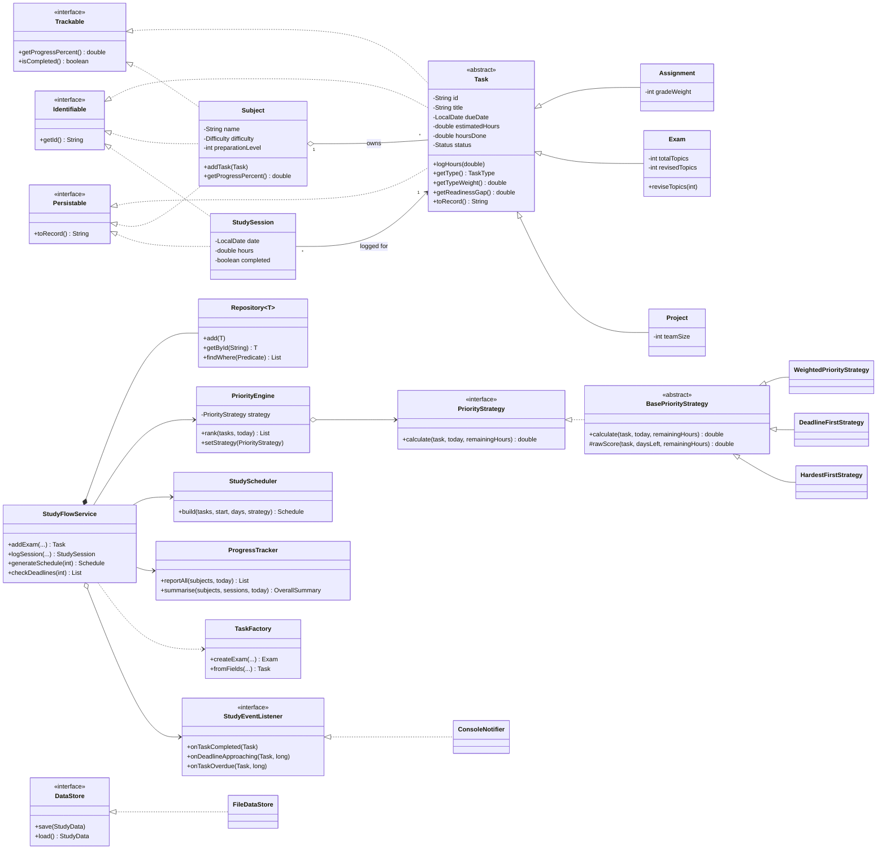

# StudyFlow: Intelligent Student Productivity System

A menu-driven Java application that tracks assignments, exams and projects, scores how urgent each one is,
monitors progress per subject, and generates a day-by-day study plan that respects every deadline.

Built for an **Object-Oriented Programming (Java)** course project. Plain Java (JDK 11+), no external libraries.

| | |
|---|---|
| Source files | 49 classes/interfaces/enums in 8 packages (about 2,900 lines including comments) |
| Tests | 43 automated tests, all passing (`./test.sh`) |
| Dependencies | none (standard library only) |
| Interface | console menu, plus a non-interactive `--demo` mode |

---

## 1. Quick start

```bash
# Linux / macOS
./build.sh            # compile
./run.sh --demo       # non-interactive tour of every feature (best for a first look)
./run.sh              # interactive menu (data is saved to studyflow-data.txt)
./test.sh             # run the 43 tests
```

```bat
:: Windows
build.bat
run.bat --demo
run.bat
test.bat
```

Manual commands (any OS, any IDE terminal):

```bash
javac -d out $(find src test -name "*.java")        # Windows: dir /s /b src\*.java test\*.java > s.txt & javac -d out @s.txt
java -cp out com.studyflow.Main --demo
java -cp out com.studyflow.TestRunner
```

**IntelliJ / Eclipse / VS Code:** create a Java project, mark `src` and `test` as source folders, run `com.studyflow.Main`
(optionally with program argument `--demo`).

Tip for the interactive menu: choose **14** first to load sample data, then try 3, 6 and 7.

---

## 2. Features

| # | Feature | Where |
|---|---|---|
| 1 | Subjects with difficulty (1-5) and self-rated preparation (0-100%) | `Subject` |
| 2 | Three kinds of task: **Assignment** (grade weight), **Exam** (topics revised, readiness), **Project** (team size) | `Assignment`, `Exam`, `Project` |
| 3 | **Priority score 0-100** and band (LOW / MEDIUM / HIGH / CRITICAL) | `strategy` package |
| 4 | Three **switchable priority strategies** (Balanced, Deadline first, Hardest first) | menu option 9 |
| 5 | Log study sessions; tasks auto-complete when the estimate is reached | `StudyFlowService.logSession` |
| 6 | Subject progress, health status (On track / Needs attention / At risk), weekly hours, suggested focus subject | `ProgressTracker` |
| 7 | **Personalised study plan**: respects daily hours and deadlines, interleaves subjects, warns when something cannot fit | `StudyScheduler` |
| 8 | Deadline alerts (approaching / overdue / completed) | Observer: `StudyEventListener` |
| 9 | Save/load to a readable text file; export plan and report to `studyflow-report.txt` | `FileDataStore`, `ReportPrinter` |
| 10 | Full input validation and clear error messages; edit deadline, update preparation, delete task/subject | `Validator`, `ConsoleApp` |

---

## 3. How it works

### 3.1 Priority score

For a task, with `d` = days left and `r` = remaining hours:

```
urgency    = 1.0 if d <= 0, else 1/(1 + 0.35*d)  (+0.1 for every hour/day above 3 needed to finish, capped at 1)
difficulty = difficulty level / 5
workload   = min(1, r / 12)
readiness  = 1 - (0.6*preparation + 0.4*topics revised)     (exams only)

score = 100 x (0.50*urgency + 0.15*difficulty + 0.15*workload + 0.20*readiness) x type weight
        (non-exams: the readiness share is added to urgency)
        +15 if overdue, clamped to 0-100
```

Type weights are **polymorphic**: Exam 1.4, Assignment 0.9-1.3 (grows with its share of the final grade),
solo Project 1.1, team Project 1.0.

### 3.2 Study-plan algorithm

For every day in the planning window:

1. **Backward feasibility pass.** Push every task's remaining hours as late as its deadline allows
   (latest deadline first). Whatever cannot be pushed later *must* be studied today.
2. **Fill the day.** Repeatedly pick the best task, where "must-do" tasks come first and then the highest priority
   score (re-scored with the hours already planned, so work naturally interleaves). Give it a block of at most
   2 hours, in half-hour slots, until the day's hours are used.
3. Never schedule a task after its deadline. Anything that genuinely cannot fit is reported as a **warning with the
   number of hours short**.

Step 1 matters: without it, a high-priority but distant exam can steal slots from a nearer deadline and the planner would
report a false "cannot fit" warning. There is a test that fails if this step is removed.

---

## 4. Object-oriented concepts and where to find them

| Concept | Where it is demonstrated |
|---|---|
| **Encapsulation** | Private fields with validated setters in `Task` and `Subject`; `Subject.getTasks()` returns an unmodifiable view; value objects such as `ScheduleEntry` and `RankedTask` are immutable |
| **Abstraction** | `abstract class Task`; `BasePriorityStrategy`; interfaces `PriorityStrategy`, `DataStore`, `StudyEventListener` |
| **Inheritance** | `Task` to `Assignment` / `Exam` / `Project`; `BasePriorityStrategy` to three strategies; exception hierarchy under `StudyFlowException` |
| **Polymorphism (overriding)** | `getTypeWeight()`, `getReadinessGap()`, `getDetails()`, `extraRecord()` behave differently per subclass; the scheduler and ranking treat every task as a plain `Task` |
| **Polymorphism (overloading)** | `PriorityStrategy.calculate(task, today)` and `calculate(task, today, remainingHours)`; two `StudyFlowService` constructors |
| **Interfaces and default methods** | `Identifiable`, `Trackable`, `Persistable`, `Comparable<Task>`; `StudyEventListener` has empty default methods so listeners implement only what they need |
| **Composition / aggregation** | `Subject` owns its `Task`s; `Task` references its `Subject`; `StudyFlowService` owns repositories, engine and scheduler |
| **Generics** | `Repository<T extends Identifiable>`: one class stores subjects, tasks and sessions |
| **Enums with state** | `Difficulty` (level, label, weight, `fromLevel`), `PriorityLevel`, `Status`, `TaskType`, `HealthStatus` |
| **Exception handling** | Checked: `StudyFlowException`, `EntityNotFoundException`, `StorageException`. Unchecked: `InvalidInputException`. Multi-catch, try-with-resources, wrapping with causes |
| **Collections, streams, lambdas** | Grouping, sorting, averaging in `ProgressTracker`, `PriorityEngine`, `Schedule`; `Comparator` chains in `StudyScheduler` |
| **Static / final / utility classes** | `Validator`, `IdGenerator`, `TextUtil`, `NumberUtil`; `final` value classes |
| **Object methods** | `equals`, `hashCode` (by id), `toString`, `compareTo` (by deadline) |
| **Packages** | `model`, `strategy`, `factory`, `service`, `storage`, `ui`, `exception`, `util` |
| **File I/O** | `FileDataStore` using `java.nio.file` and a pipe-delimited, escaped record format |

### Design patterns

| Pattern | Class(es) | Purpose |
|---|---|---|
| **Strategy** | `PriorityStrategy`, `PriorityEngine` + 3 strategies | change how priority is computed at run time without touching other code |
| **Factory** | `TaskFactory` | one place that knows how to build each task type, including from saved records |
| **Observer** | `StudyEventListener`, `ConsoleNotifier` | alerts are decoupled from the logic that detects them |
| **Template Method** | `Task.toRecord()`, `BasePriorityStrategy.calculate()` | fixed algorithm skeleton, subclasses fill in the steps |
| **Facade** | `StudyFlowService` | the UI talks to one simple class |
| **Repository** | `Repository<T>` | uniform storage/lookup of entities |
| **Dependency injection** | `StudyFlowService(Clock)`, `ConsoleApp(service, store)` | testable time and swappable storage |

### SOLID

* **S**: each class has one job (`ReportPrinter` only formats, `FileDataStore` only does file I/O, the UI has no business rules).
* **O**: add a new priority rule or a new task type without editing existing logic.
* **L**: any `Task` subclass can be used wherever `Task` is expected (the scheduler never checks types).
* **I**: small interfaces (`Identifiable`, `Trackable`, `Persistable`).
* **D**: the application depends on `DataStore` and `PriorityStrategy` abstractions, not concrete classes.

---

## 5. Class diagram



(GitHub, GitLab, VS Code and most Markdown viewers render the Mermaid diagram. Paste the block into
https://mermaid.live to export it as an image for your report.)

---

## 6. Project structure

```
StudyFlow/
├── src/com/studyflow/
│   ├── Main.java                 entry point
│   ├── model/                    Task (abstract), Assignment, Exam, Project, Subject, StudySession,
│   │                             enums (Difficulty, Status, TaskType, PriorityLevel), interfaces
│   ├── strategy/                 PriorityStrategy + 3 implementations, PriorityEngine, RankedTask
│   ├── factory/                  TaskFactory
│   ├── service/                  StudyFlowService (facade), StudyScheduler, Schedule, ProgressTracker,
│   │                             Repository<T>, reports, StudyEventListener
│   ├── storage/                  DataStore, FileDataStore, StudyData
│   ├── ui/                       ConsoleApp, ConsoleInput, ReportPrinter, ConsoleNotifier, DemoData, DemoRunner
│   ├── exception/                StudyFlowException, EntityNotFoundException, StorageException, InvalidInputException
│   └── util/                     Validator, IdGenerator, TextUtil, NumberUtil
├── test/com/studyflow/TestRunner.java    43 tests
├── docs/PROJECT_REPORT.md        report text for submission
├── docs/VIVA_QA.md               likely viva questions with answers
└── build.sh run.sh test.sh (+ .bat)
```

## 7. Testing

`./test.sh` runs 43 tests covering validation, polymorphism, every priority rule, strategy switching, the scheduler
(capacity, deadlines, infeasible work, starvation), reports, the Observer, and persistence (round trip, special
characters, id collisions, corrupted and missing files). The scheduler tests were checked by deliberately removing the
feasibility pass, and they fail as they should.

The tests use a small hand-written runner instead of JUnit so that the project has no dependencies. Porting them to JUnit 5 is
mechanical if your course requires it.

## 8. Limitations and ideas for extension

* Console interface only (the `ui` package is the only layer to replace for a JavaFX/Swing GUI).
* Preparation level is self-rated and not learned from results.
* The scheduler is a heuristic (greedy plus a feasibility pass), not an exact optimiser.
* Possible extensions: recurring tasks, break/Pomodoro blocks, exam-score history to update preparation automatically,
  database storage by implementing `DataStore`, e-mail reminders by implementing `StudyEventListener`.
